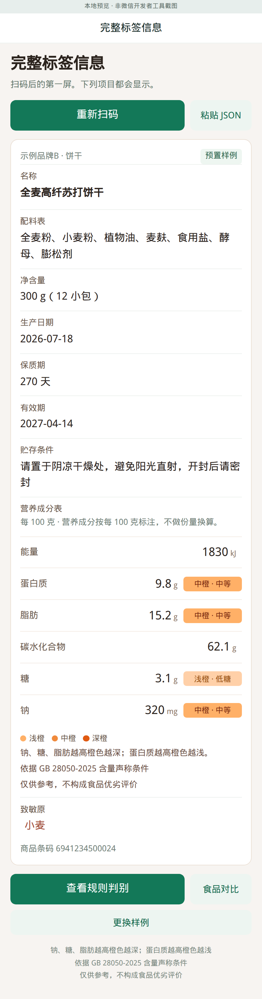
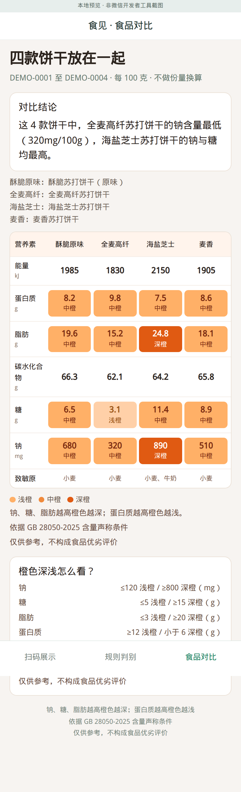
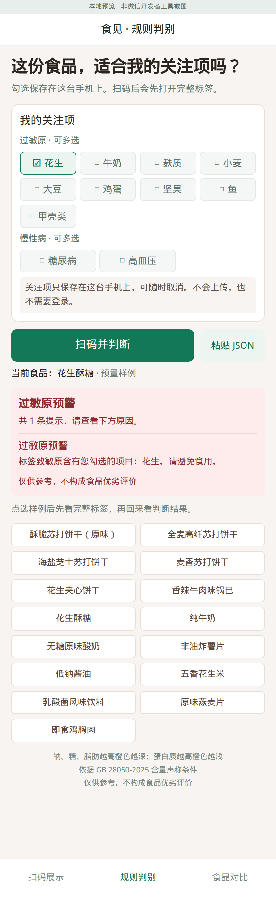
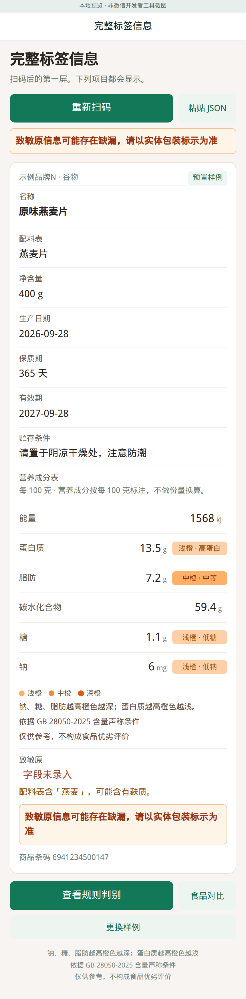

# 食见 · 食品标签助手

竞赛用微信原生小程序原型。扫一张预置 JSON 测试码，或点选 15 条虚构样例，**第一屏是完整标签信息**。营养色阶用同一色相的浅橙、中橙、深橙，不使用红黄绿。过敏原和慢性病勾选只写在手机本地。

不需要云开发、后端、登录、AI 或域名。数据在 `miniprogram/data/products.json`。

| 完整标签（预览） | 橙色深浅（预览） | 花生预警（预览） | 致敏原缺漏（预览） |
| --- | --- | --- | --- |
|  |  |  |  |

上表四张是浏览器对同一套 WXML 的预览截图，画面顶部写有「本地预览 · 非微信开发者工具截图」。本次改动没有在微信开发者工具里重拍。`docs/screenshots/01-scan.png` 至 `04-compare.png` 是上一版三款样例、红橙绿配色的开发者工具截图，不能当作当前界面。

## 在微信开发者工具中运行

1. 打开微信开发者工具，选择「导入」。
2. 选择**包含 `project.config.json` 的项目根目录**，不要只选 `miniprogram`。
3. 项目类型选「小程序」。换账号时用「测试号」，并选择「不使用云服务」。
4. 点击「编译」。底部有「扫码展示」「规则判别」「食品对比」。**不需要构建 npm。**

## 怎么演示

1. 在「扫码展示」点「全麦高纤苏打饼干」，或扫 `docs/qrcodes/DEMO-0002.png`。第一屏是「完整标签信息」，能看到名称、配料表、净含量、生产日期、保质期、有效期、贮存条件、营养成分表、致敏原。
2. 营养成分旁是浅橙 / 中橙 / 深橙。色阶旁边和页面底部都有：**仅供参考，不构成食品优劣评价**。并注明依据 GB 28050-2025 含量声称条件。
3. 打开「食品对比」。四款饼干按每 100 克比较，不做份量换算。结论文案是：这 4 款饼干中，全麦高纤苏打饼干的钠含量最低（320mg/100g），海盐芝士苏打饼干的钠与糖均最高。
4. 打开「规则判别」。勾选只保存在这台手机，文案写明不会上传、也不需要登录。存储键仍是 `food-demo-profile`，读写方式没有改。
5. 勾选「花生」后点「花生酥糖」，先进入完整标签，再点「查看规则判别」，出现过敏原预警。对照用「纯牛奶」，不应触发花生。
6. 点「原味燕麦片」（DEMO-0014）。致敏原字段是空的，配料是「燕麦片」。页面会给出缺漏提示，原文是：**致敏原信息可能存在缺漏，请以实体包装标示为准**。这条不要删。

扫码按钮调用 `wx.scanCode({ onlyFromCamera: false, scanType: ['qrCode'] })`。开发者工具里可以选择 PNG。也可以粘贴同名 JSON，或只粘贴 `DEMO-0007` 这样的编号。不要用微信主界面的扫一扫代替小程序里的按钮。

建议截图的对照：花生用 DEMO-0007 花生酥糖，不触发用 DEMO-0008 纯牛奶。

## 样例数据

`miniprogram/data/products.json` 有 DEMO-0001 至 DEMO-0015，品牌是示例品牌A–O。营养成分一律按每 100 克或每 100 毫升，对比页不换算成每份。

| 用途 | 编号 |
| --- | --- |
| 四款饼干对比 | DEMO-0001 至 DEMO-0004，品类都是饼干 |
| 应触发花生 | DEMO-0005、0006、0007、0012 |
| 不应触发花生 | DEMO-0008、0009、0010、0013 |
| 致敏原字段缺失 | DEMO-0014 原味燕麦片 |
| 糖尿病，糖 13.6 g/100mL | DEMO-0013，不建议食用 |
| 糖尿病，糖 4.2 g/100g | DEMO-0009，推荐食用 |
| 高血压，钠 4800 mg/100mL | DEMO-0011，不建议食用，并说明按每份食用量计 |
| 高血压，钠 780 mg/100g | DEMO-0015，谨慎少量 |
| 勾选后仍无警示 | DEMO-0010 |

`note` 只写测试意图，界面不展示。配料、贮存条件、净含量和生产日期是按规格补全的虚构文字。

## 色阶和规则

含量色阶，数值越高橙色越深；蛋白质相反，越高橙色越浅。这不是食品优劣评价。

| 成分（每 100g 或 100mL） | 浅橙 | 中橙 | 深橙 |
| --- | --- | --- | --- |
| 钠，mg | ≤120 低钠 | 介于中间 | ≥800 高钠 |
| 糖，g | ≤5 低糖 | 介于中间 | ≥15 高糖 |
| 脂肪，g | ≤3 | 介于中间 | ≥20 高脂 |
| 蛋白质，g | ≥12 高蛋白 | ≥6 且 <12 | <6 |

高钠、低钠、高糖、低糖、高脂、高蛋白用的是样例说明里的 GB 28050-2025 含量声称条件。脂肪 ≤3 g、蛋白质 6 g 只是为了分成三档。页面写的是「依据 GB 28050-2025 含量声称条件」。正式文本仍以标准原文为准。

慢性病是另一套 if-else，和色阶不是同一个开关：

- 糖尿病：糖 ≤5 g 为「推荐食用」；糖 ≥12 g 为「不建议食用」。所以乳酸菌饮料 13.6 g 会提示不建议食用，色阶仍是中橙，因为还没到高糖声称 15 g。糖 ≥15 g 时会写明达到高糖声称。
- 高血压：钠 ≥800 mg 为「不建议食用」；750–799 mg 为「谨慎少量」，所以 780 mg 的鸡胸肉落在这一档。调味品达到高钠时附加「请按每份食用量计」，数字仍是每 100 毫升，不换算。
- 过敏原按字段文字匹配。标签写「小麦」时，勾选「小麦」或「麸质」都会预警。DEMO-0014 的字段为空，不从字段告警，再按配料关键词识别「燕麦」并提示可能含有麸质，同时展示上面的缺漏原句。

未触发时写「无警示」或「未触发已选规则」，不写安全、适合食用。

## 关注项只在本机

规则页勾选调用 `wx.setStorageSync('food-demo-profile', { allergens, conditions })`，读取用 `wx.getStorageSync`。没有 `wx.request`、云开发或上传。重新编译可能还留着勾选，可以逐项取消，或在开发者工具里清缓存。

## 文件

```text
project.config.json
miniprogram/data/products.json   15 条虚构商品
miniprogram/pages/scan/          扫码入口
miniprogram/pages/label/         完整标签信息（扫码后的第一屏）
miniprogram/pages/rules/         本机关注项和 if-else
miniprogram/pages/compare/       四款饼干
docs/qrcodes/                    DEMO-0001.png 至 DEMO-0015.png
docs/screenshots/                05–08 为本次浏览器预览
```

有 Node.js 时可以跑 `npm test`。`npm run preview` 打开 `http://127.0.0.1:4173`，只用于看界面，不参与小程序运行。重新生成二维码需要 Python、Pillow 和 reportlab：`python3 tools/generate_qr.py`。
