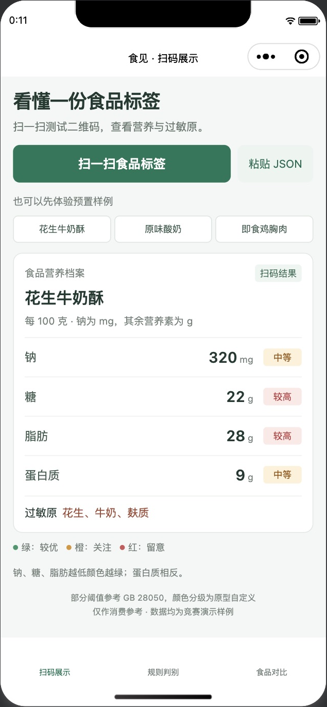
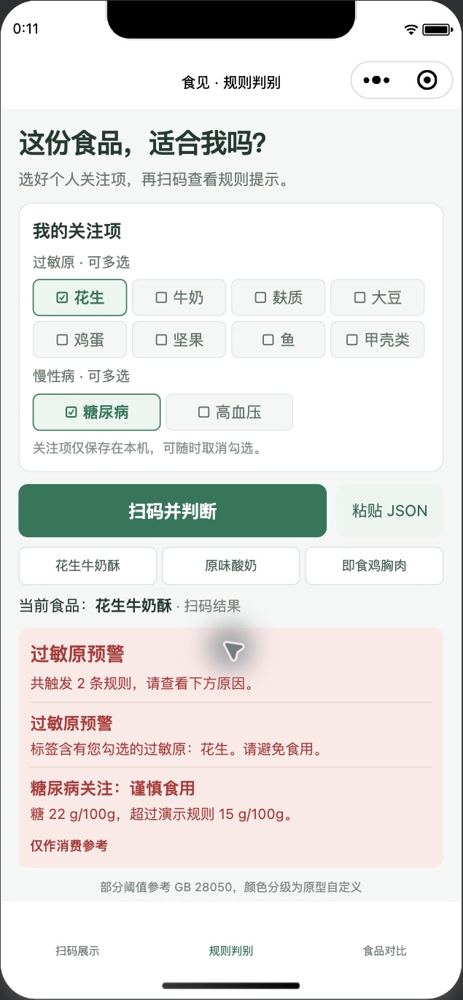
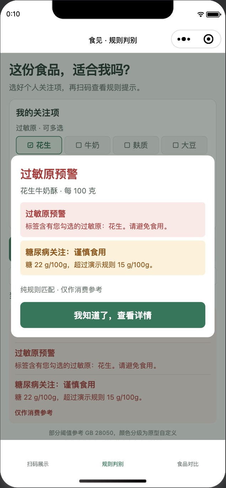
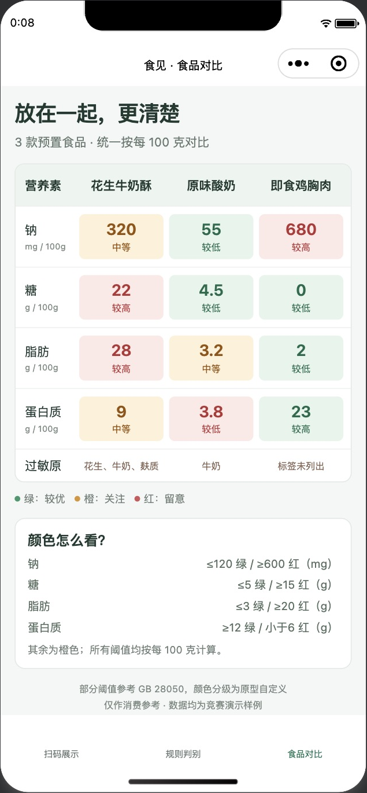

# 食见 · 食品标签助手

竞赛用微信原生小程序原型。三个页面：扫码展示、规则判别、食品对比。数据全部在本地；无需云开发、后端、AI、域名或依赖安装，不上传用户关注项。

已在微信开发者工具完成编译、二维码图片识别及预警实测。源码仓库为私有仓库；获授权后可用 `Code → Download ZIP` 下载，解压后直接导入。

| 扫码展示 | 规则判别 | 预警弹窗 | 食品对比 |
| --- | --- | --- | --- |
|  |  |  |  |

首次使用请看 [操作与演示指南](docs/GUIDE.md)：导入、扫码演示、修改样例、截图配文，以及微信端查看与分享说明。

## 在微信开发者工具中运行

1. 解压交付包，打开微信开发者工具，选择「导入（Import）」。
2. 选择**包含 `project.config.json` 的整个项目目录**，不要单独选择 `miniprogram` 子目录。
3. 当前配置已保存本次实测使用的测试号 AppID；同一账号可直接使用。换账号导入时，点击「测试号（Test Account）」使用工具分配的测试号，并选择「不使用云服务（Use no cloud service）」。
4. 项目类型选择「小程序」，点击「创建（Create）」进入项目，再点击右上方「编译」按钮。默认进入「扫码展示」，底部可切换其他两页。**不需要点“构建 npm”**。

开发者工具本身可能需要微信扫码登录；本项目不涉及上线、发布或备案流程。导入界面与测试号入口可能因开发者工具版本有所不同。

## 一分钟验收

1. 进入「规则判别」，勾选「花生」和「糖尿病」。
2. 点击「扫码并判断」，在弹出的文件选择窗口中选择 `docs/qrcodes/peanut-crisp.png`。预期弹出红色「过敏原预警」，同时列出「糖尿病关注：谨慎食用」。本次已通过开发者工具实际识码验证此流程。
3. 关闭弹窗，只保留「高血压」，识别 `chicken-breast.png`。预期弹出「谨慎食用」，显示钠 680 mg/100g。
4. 进入「食品对比」，查看三款食品四项营养成分与过敏原。

原生按钮调用 `wx.scanCode({ onlyFromCamera: false, scanType: ['qrCode'] })`。本次实测版本使用文件选择窗口识别二维码图片，能正确解析其中的中文 JSON。界面也保留「粘贴 JSON」和样例按钮，便于演示与排查。不要用微信主界面的扫一扫代替小程序内的扫码按钮；手机摄像头扫码未在本次验证范围内。

## 文件说明

```text
project.config.json           开发者工具导入配置
miniprogram/                  小程序源码（交付核心，无依赖）
  pages/scan/                 扫码解析与营养档案
  pages/rules/                关注项、规则结果、预警弹窗
  pages/compare/              三款食品并排比较
  data/foods.js               预置数据
  utils/food.js               JSON 校验
  utils/nutrition.js          营养分级
  utils/rules.js              纯 if-else 判别规则
  utils/scan.js               原生 wx.scanCode 接口
docs/qrcodes/                 三张真实 JSON 二维码、对应 JSON、汇总图
docs/screenshots/             四张微信开发者工具原生页面截图
docs/verification/            开发者工具完整窗口截图，保留验证上下文
tests/                        规则与页面处理函数测试
preview/                      可选浏览器预览，不参与小程序运行
tools/generate_qr.py          可选二维码生成脚本
```

## 二维码内容

所有数据统一为每 **100 克**。钠单位为 **mg**，糖、脂肪、蛋白质单位为 **g**。暂不接收每100mL、每份、商品条形码或网址。

```json
{
  "id": "peanut-crisp",
  "name": "花生牛奶酥",
  "basis": "100g",
  "sodium": 320,
  "sugar": 22,
  "fat": 28,
  "protein": 9,
  "allergens": ["花生", "牛奶", "麸质"]
}
```

`id` 可省略，其他字段必填；营养值必须为非负有限数字，不能用 `"22g"` 这样的字符串。过敏原未列出时用 `[]`，页面显示「标签未列出」，不会推断“无过敏风险”。过敏原按数组文字精确匹配，请使用「花生、牛奶、麸质、大豆、鸡蛋、坚果、鱼、甲壳类」等选项文字，不自动识别同义词或“可能含有”语句。单个二维码最长4096字符。

## 规则和边界

| 成分（每100g） | 绿色 | 橙色 | 红色 |
| --- | --- | --- | --- |
| 钠，mg | ≤120 | >120 且 <600 | ≥600 |
| 糖，g | ≤5 | >5 且 <15 | ≥15 |
| 脂肪，g | ≤3 | >3 且 <20 | ≥20 |
| 蛋白质，g | ≥12 | ≥6 且 <12 | <6 |

原需求区间的重叠端点已明确为上表；没有浮点四舍五入后再判断的行为。

- **过敏原**：任一勾选项与食品过敏原匹配，显示红色预警。
- **糖尿病**：勾选且糖 **>15g/100g**，提示「谨慎食用」。糖等于15时营养颜色为红，但不触发此项规则。
- **高血压**：勾选且钠 **≥600mg/100g**，提示「谨慎食用」。这是本原型选用的演示阈值。
- 多个条件同时命中时全部展示，红色过敏原预警优先。
- 未选择关注项会提示选择；未命中只说明「未触发已选规则」，不会输出“安全”或“适合食用”结论。
- 勾选项存在本地 storage；重新编译可能保留，可逐项取消或使用开发者工具清除缓存。食品结果仅在本次运行内跨页共享。

## GB 28050 表述说明

**红橙绿分级和慢性病提示是原型自定义规则，不是 GB 28050 规定的疾病判断或颜色分级。** 页面已写明「部分阈值参考 GB 28050，颜色分级为原型自定义」「仅作消费参考」。

GB 28050—2011 附录C支持低钠≤120mg、低糖≤5g及固体低脂≤3g；每100g的蛋白质来源/高蛋白条件对应6g/12g。该标准没有将600mg钠、15g糖或20g脂肪规定为本原型使用的红色阈值。液体和其他计量基础的声称条件有所不同，本项目只演示每100g数据。[国家卫健委标准全文](https://www.nhc.gov.cn/sps/c100088/201111/714fdca49f15450580fc03a2ee3163f9/files/1732844863395_24655.pdf)

截至2026年11月，2025版处于实施前过渡期，实施日期为2027年3月16日。本原型没有自动切换标准版本。[国家卫健委新版标准问答](https://www.nhc.gov.cn/sps/c100087/202509/470fa4ff5de14dd38619223cce9da4e7.shtml)

## 验证范围与截图来源

- 已完成：19项自动测试，覆盖四项营养边界、严格JSON校验、并发预警、原生扫码回调处理、取消/失败、页面间共享、关注项保存和对比数据。
- 已实测：微信开发者工具 **2.02.2609250 Stable**，通过测试号、无云服务导入并编译成功；实际调用 `wx.scanCode` 识别中文 JSON；花生与糖尿病同时触发红色预警，高血压扫描鸡胸肉触发高钠提示。手机预览二维码也已生成。
- 已提供：`docs/screenshots/01-scan.png`（扫码展示）、`02-rules.png`（规则判别）、`03-warning.png`（预警弹窗）、`04-compare.png`（食品对比）。这些是从微信开发者工具实际运行窗口裁出的页面截图；完整验证范围见 [验证记录](docs/verification/README.md)。完整工具窗口截图仅保留本机，不上传仓库。
- 未实测：手机摄像头扫码。开发者工具的图片识码已验证，不等同于真机摄像头验证。

有 Node.js 时可选运行：

```bash
npm test
npm run preview
```

预览地址为 `http://127.0.0.1:4173`。无需 `npm install`。运行小程序本身不需要 Node.js，也不需要启动这个预览服务。
